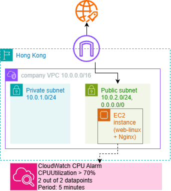
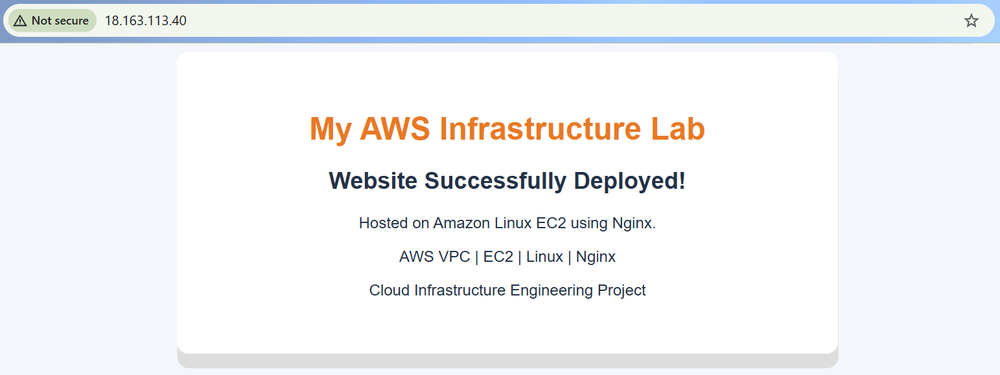
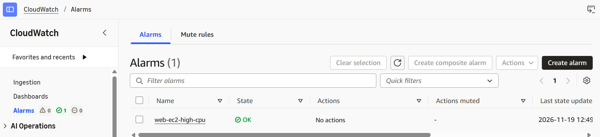
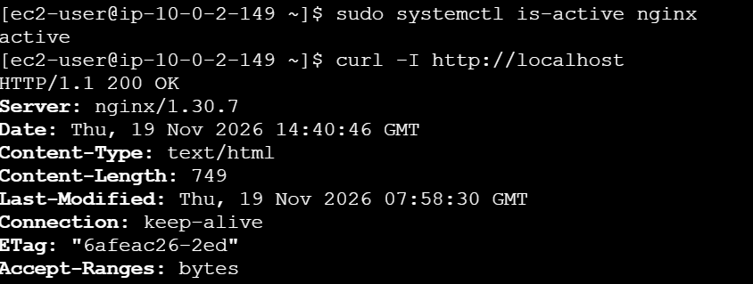

# AWS VPC, EC2 & Linux Infrastructure

## Project Overview
This project demonstrates hands-on deployment and basic operations of an AWS-hosted Linux web server.

## Architecture Diagram

## Project Implementation
- Amazon VPC
- Amazon EC2 (Amazon Linux)
- Internet Gateway and Route Tables
- Security Groups
- Nginx
- Amazon CloudWatch
- EC2 Instance Connect
- Linux CLI

## Architecture Component
| Component | Configuration |
| :--- | :--- |
| **VPC** | 10.0.0.0/16 |
| **Private Subnet** | 10.0.1.0/24 |
| **Public Web Subnet** | 10.0.2.0/24 |
| **Internet Gateway** | Attached to VPC |
| **Public Route Table** | 0.0.0.0/0 (Internet Gateway) |
| **EC2** | Amazon Linux instance in public subnet |
| **Web Server** | Nginx |
| **Monitoring** | CloudWatch CPU alarm |

## Implementation
1. Created a VPC with separate public and private subnets.
2. Configured an Internet Gateway and public subnet routing.
3. Launched an Amazon Linux EC2 instance.
4. Connected to the instance using EC2 Instance Connect.
5. Installed Nginx and deployed a custom HTML website.
6. Verified HTTP 200 locally and from a browser using the EC2 public IP.
7. Created a CloudWatch CPU utilization alarm with a threshold of 70% and 2 out of 2 evaluation periods.
8. Simulated an Nginx service outage.
9. Investigated the service status, HTTP connectivity, listening ports and logs.
10. Restored Nginx and confirmed HTTP 200.

## Troubleshooting Documentation
[View Linux Troubleshooting Report](troubleshooting.md)

## Testing and Validation

### 1. Nginx Website

### 2. CloudWatch CPU Alarm

### 3. Linux Service Recovery

## Project Scope
This is a guided hands-on learning project demonstrating foundational AWS infrastructure and operational skills. It is not intended to represent a production-ready deployment.

  
